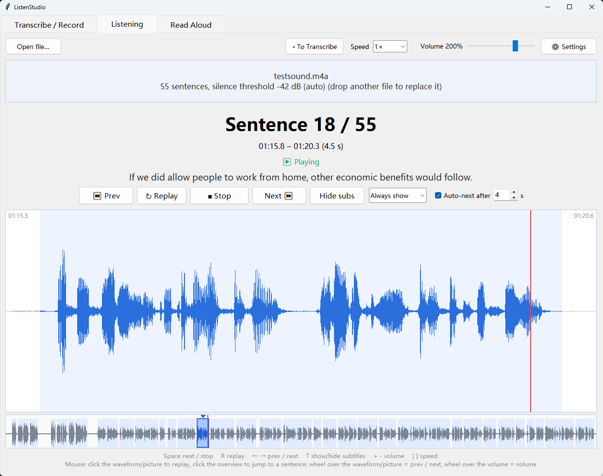
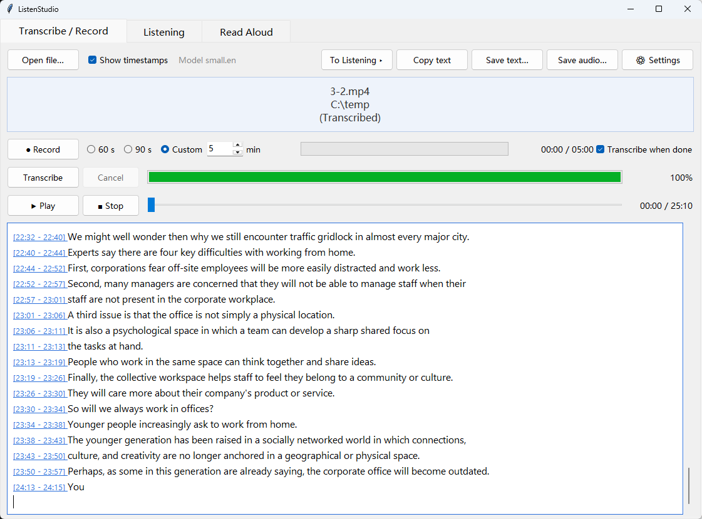
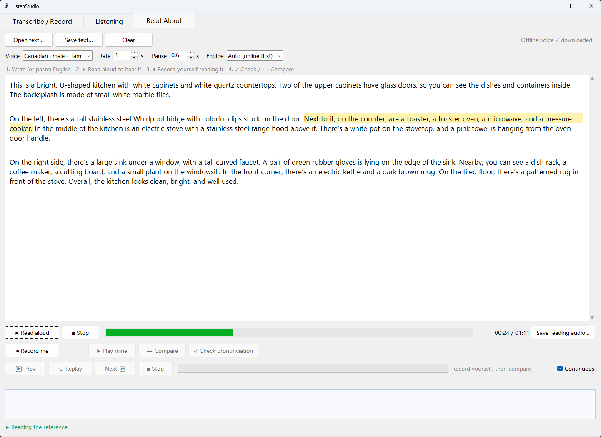

# ListenStudio

A desktop app for practising English listening and speaking. Drop in any audio or video file to transcribe it with Whisper, listen to it sentence by sentence, or write your own text, hear it read aloud and compare your pronunciation with the reference, sentence by sentence.

> The interface is available in English and Chinese (中文).



| Transcribe | Read aloud |
|---|---|
|  |  |

## Features

### 1. Transcribe / Record (转录 / 录音)
- Drag and drop audio or video (mp3, m4a, wav, flac, ogg, mp4, mkv, mov, …) and transcribe it to timestamped text with **Whisper** (faster-whisper or openai-whisper; uses an NVIDIA GPU when available).
- Transcription runs in a background thread, so the window stays responsive; it can be paused and cancelled.
- Record from a chosen microphone (60 s, 90 s or a custom length up to 60 min). Audio is written to disk while recording, so long recordings don't fill memory.
- Save audio as WAV, MP3, M4A or FLAC.

### 2. Intensive listening (精听)
- Splits the audio into sentences at the silences. The silence threshold is set automatically from the recording's noise floor; long sentences are split again.
- Plays one sentence at a time and pauses, with an optional auto-advance after N seconds.
- Zoomed waveform of the current sentence plus a clickable overview of the whole file; video files show the picture in sync.
- Optional Whisper subtitles, cached so each file is only recognised once.
- Speed 0.5×–1.5× **without changing pitch**, and volume boost with a limiter so loud parts never clip.
- Keyboard driven: `Space` play / stop, `R` replay, `←` / `→` previous / next, `T` subtitles, `[` / `]` speed, `+` / `-` volume.

### 3. Read aloud (朗读)
- Write or paste your own English; it is read aloud with neural voices (Canadian, US and UK accents), highlighting the sentence being read.
- Two text-to-speech engines: **Microsoft Edge online voices**, with **Kokoro** as an offline fallback (≈120 MB model, downloaded on first use).
- Record yourself reading the text, then **check pronunciation**: Whisper transcribes your recording and it is aligned word by word with the text. Skipped words are marked red, misread words orange, and you get the share of words read correctly.
- **Compare sentence by sentence**: plays the reference sentence, then yours, with previous / replay / next / stop and a continuous-play option.

The Transcribe and Listening tabs can send the current file to each other, and switching tabs stops playback on the tab you leave.

## Installation

### Run from source (Windows, macOS)

Requires **Python 3.10+** with Tk (included in the python.org installers).

```bash
git clone https://github.com/MattSi/ListenStudio.git
cd ListenStudio
python -m venv .venv
# Windows: .venv\Scripts\activate    macOS / Linux: source .venv/bin/activate
pip install -r requirements.txt
pip install faster-whisper          # needed for transcription, subtitles and the pronunciation check
python app.py
```

Optionally open a file straight away:

```bash
python app.py lecture.m4a
```

Notes:
- No ffmpeg command-line tools are needed: all decoding, playback and conversion go through **PyAV**.
- `openai-whisper` also works in place of `faster-whisper`. With an NVIDIA GPU and a CUDA build of PyTorch it runs on the GPU.
- The Whisper model (tiny.en … large-v3, turbo) is chosen in **⚙ 设置** (Settings) and shared by all tabs.
- Settings are saved to `settings.json` and recordings to `recordings/`, both next to `app.py` and ignored by git.

### macOS app

Download a build from the [Actions page](../../actions/workflows/build-mac.yml) (Apple silicon and Intel), or build it on a Mac:

```bash
bash build_mac.sh      # outputs dist/ListenStudio.app and a zip
```

The `.app` does not bundle Whisper (PyTorch is over 1 GB). For transcription it looks for a Python on the computer that has Whisper installed (`pip3 install faster-whisper`), or the one named in the `JINGTING_PYTHON` environment variable. In the packaged app, settings go to `~/Library/Application Support/ListenStudio/` and recordings to `~/Music/ListenStudio/`.

## Project structure

| File | What it does |
|---|---|
| `app.py` | Entry point: the window, the three tabs and command-line options |
| `transcriber.py` | Transcribe / Record tab: Whisper worker thread, recording, audio conversion |
| `intensive_listening.py` | Listening tab: silence-based sentence splitting, waveform, video, subtitles, speed and volume |
| `reader.py` | Read-aloud tab: recording, word-level alignment, sentence-by-sentence comparison |
| `tts.py` | Text to speech: Edge online voices, Kokoro offline fallback, per-sentence timing, cache |
| `audio_io.py` | Audio device selection |
| `app_paths.py` | Where settings, recordings, models and cache are stored |
| `ui_style.py` | Shared fonts and colours |
| `build_mac.sh`, `.github/workflows/build-mac.yml` | macOS packaging with PyInstaller, and the CI job that runs it |

